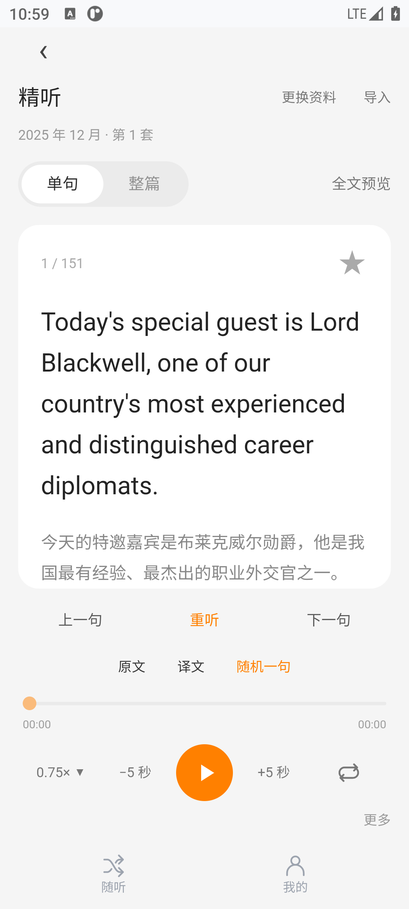
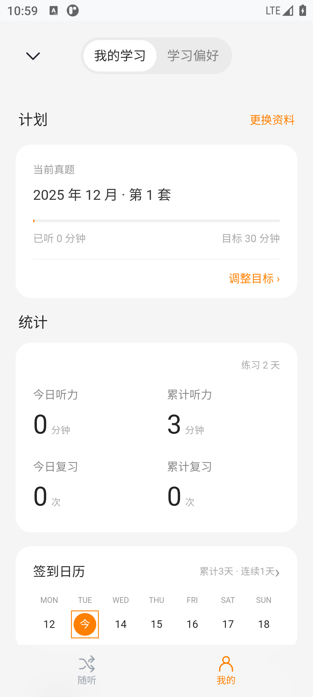
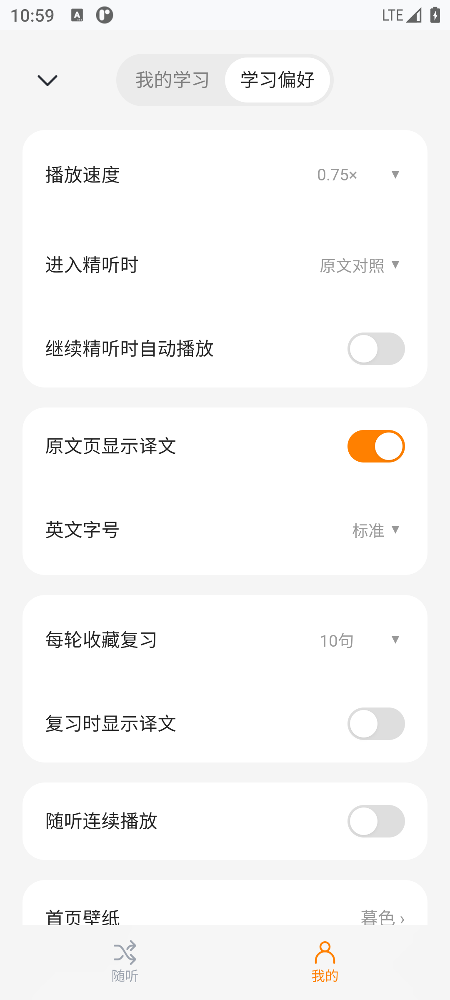

# 不听听力

一款无需登录的 Android 英语听力练习应用。用整篇录音练理解，用随机单句练细节；原文、译文、慢放和全文点播放在同一个练习界面中。

**当前正式版：2.0.0 · Android 8.0 及以上 · ARM64 手机 / 平板，x86_64 模拟器。**

[下载安装包](https://github.com/happypotato2024/buting-listening/releases/latest) · [使用说明](docs/使用说明.md) · [常见问题](docs/常见问题.md) · [版本记录](CHANGELOG.md) · [问题反馈](https://github.com/happypotato2024/buting-listening/issues)

## 能做什么

- **真题精听**：现有资料库提供 2019—2025 年 29 组六级录音、4,507 条单句原文、参考译文和时间标记，不代表这些年份全部官方套卷。
- **整篇与单句播放**：暂停、拖动进度、前后跳转 5 秒、0.5—1.5 倍速、单句循环。整篇播放时，可从全文中点选一句继续听。
- **随听与复习**：随机抽句、重听、显示或隐藏原文与译文；收藏难句，之后从 Review 复习。
- **自行导入**：导入英语 MP3、M4A 或 WAV，本机识别并生成句子时间标记，联网获取中文参考译文；识别、对齐和翻译结果均可存在误差。
- **后台播放**：通知栏与锁屏媒体控制，耳机媒体键控制，切到其他应用后继续听。
- **本机学习记录**：签到、听力时长、目标、收藏、字号偏好和自定义首页壁纸；无需注册账户。
- **手机 / 平板适配**：手机上下布局，宽屏分栏；长原文独立滚动，播放区保持可见。

## 界面预览

以下为 2.0 模拟器实测截图。

  

## 三步开始

1. 在 [Releases](https://github.com/happypotato2024/buting-listening/releases/latest) 下载 `buting-listening-v2.0.0.apk` 并安装。已安装旧正式版时，直接覆盖安装，保留原有记录。
2. 打开「我的 → 更换资料」，选择真题并进入练习；也可在精听页选择「更换资料」。
3. 在「单句 / 整篇」之间切换，用播放键、原文 / 译文和「全文预览」开始练习。

APK 约 **16.6 MB**，不内置完整录音或识别模型。真题按需在线播放，也可保存完整录音供离线使用。下载安装包本身不代表所有音频已下载。

个人录音首次识别需另下载约 **148 MB** 模型；可选本机翻译另需约 **1.12 GB** 模型。仅使用预处理真题库不需要下载这两个模型。

## 数据与网络

个人录音在设备本机识别。默认联网翻译会将英文文本发送给 Google；录音不随翻译上传。可选本机翻译在模型下载完成后离线运行。应用的日志由用户主动导出，不自动上传。

音频、模型下载和联网翻译取决于服务可达性；已完整保存的录音和已生成的句子可离线使用。学习记录保存在本机，暂无账号同步或跨设备备份恢复功能，卸载 / 清除数据会删除记录。详见 [数据与隐私说明](docs/数据与隐私.md)。

## 项目结构

| 目录 | 内容 |
| --- | --- |
| `listening-android/` | 正式版 WebView 界面、Android 桥接与正式版构建脚本 |
| `listening-lab/src/`、`native/` | 共用的原生播放、识别、翻译、缓存与 JNI 引擎；正式版构建时注入固定两线程策略 |
| `listening-app/` | 正式版使用的基础网页脚本 |
| `docs/` | 使用说明、常见问题、构建说明、隐私说明、截图与验证记录 |

音频资料独立维护在 [buting-listening-resources](https://github.com/happypotato2024/buting-listening-resources)，本仓库不重复存储数百 MB 录音。安装包和便携发布压缩包放在 Releases。

源码按正式版构建依赖整理。构建工具目前面向 Windows，依赖本机 SDK / NDK 与签名配置，详见 [构建说明](docs/构建说明.md)。

## 反馈与验证范围

反馈时请提供手机型号、Android 版本、应用版本、资料名称和复现步骤；可从「我的 → 学习偏好 → 导出使用日志」导出日志。公开提交前检查日志与附件是否包含个人内容。

2.0 已在 Android 11 x86_64 模拟器上验证三种屏幕配置、播放流程、后台播放、失败重试及升级后数据保留；未完成 ARM64 实体设备的全面测试。固定 2 线程和过热暂停不代表导入过程不会发热。详见 [验证记录](docs/验证结果-v2.0.md)。

## 来源与权利说明

本项目为独立听力练习项目，与「不背单词」无隶属、合作或官方授权关系。

真题资料来源及许可、Whisper / whisper.cpp、llama.cpp 与 Qwen 的许可见 [第三方说明](THIRD_PARTY_NOTICES.md)。参考译文包含机器翻译，不是官方答案。仓库公开展示源码，目前未对项目自有代码与图标另行授予开源许可；第三方内容遵循各自许可。
